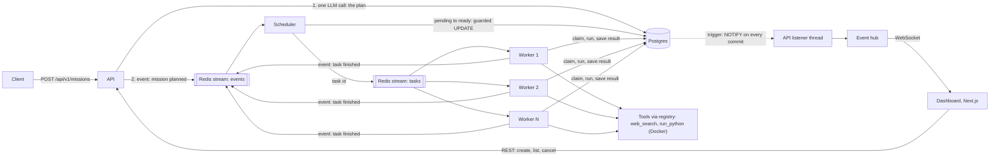
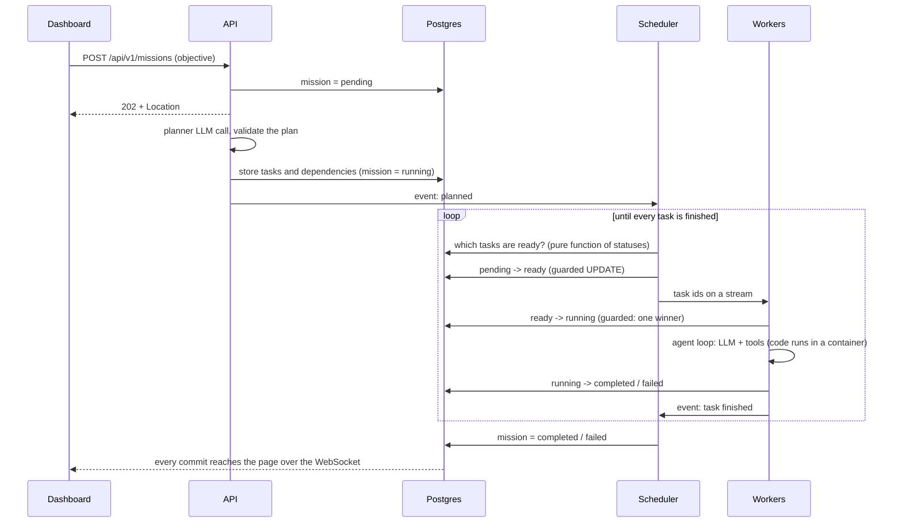

# AgentOS

A stateful multi-agent execution runtime: it plans a natural-language objective into a task graph,
schedules the tasks across worker processes over a message queue, enforces permissions on every
tool call, runs agent-written code in a locked-down container, and streams progress live.

> The model decides what it wants to do; the runtime decides whether it can.

**Status:** v1 (milestones M0-M3) completed. Planning, DAG scheduling, distributed workers, three agents,
sandboxed code execution, a live dashboard, and a one-command container deployment. Reliability
(M4) and security (M5) completed; today the API has no login of its own, so the deployment puts
one in front of every write. See [docs/ROADMAP.md](docs/ROADMAP.md), [docs/API.md](docs/API.md),
[docs/RELIABILITY.md](docs/RELIABILITY.md) (what survives a crash, and what does not), [docs/FAILURE_TESTING.md](docs/FAILURE_TESTING.md) (how it is tested), [docs/POSTMORTEM.md](docs/POSTMORTEM.md), [docs/DEPLOY.md](docs/DEPLOY.md) and [frontend/README.md](frontend/README.md).

<!-- Uncomment once docs/media/demo.gif exists (see docs/DEMO.md):

-->

## Architecture



- **Postgres is the source of truth.** Redis streams carry only ids ("look at this task").
- **Effectively-once execution on at-least-once delivery.** Every status change is a guarded
  `UPDATE`, so when a message is delivered twice, only one worker wins the claim.
- **Workers scale by running more of them.** Parallelism is measured, not claimed:
  see [docs/BENCHMARKS.md](docs/BENCHMARKS.md) (generate it with `make bench`).
- **Live updates come from the database itself.** A trigger announces every committed change;
  the API turns them into WebSocket messages. A rolled-back change is never announced, and no
  writer can forget to publish.
- **The registry, not the prompt, decides what an agent may do.** Agents hold capabilities;
  a tool call without the matching capability is refused.
- **Agent-written code runs in a container** (no network, read-only filesystem, no capabilities,
  non-root, memory/CPU/process limits) and the tool fails closed if Docker is unavailable.

### One mission, end to end



### Measured, not claimed

On a benchmark of fixed-duration tasks (so the runtime is measured, not the LLM), an 8-way fan-out
runs **2.42x faster with 4 workers than sequentially** (5.64 s to 2.33 s), while a dependency chain
correctly does not speed up. Method, machine and every number: [docs/BENCHMARKS.md](docs/BENCHMARKS.md).
Real LLM tasks scale less, because a single local model may serialise requests.

## Run it with Docker (everything in containers)

```bash
cp .env.example .env     # set POSTGRES_PASSWORD, LLM_*, TAVILY_API_KEY, DOCKER_GID, ADMIN_PASSWORD_HASH
make hash-password       # makes the hash for the admin login
make prod-up             # builds and starts: Postgres, Redis, API, scheduler, worker, dashboard, Caddy
```

Open http://localhost:8080. The same compose file deploys to a public host with automatic HTTPS.
**Read [docs/DEPLOY.md](docs/DEPLOY.md) first**: it explains the login gate, the Docker-socket
trade-off of the code sandbox, and the known limits.

## Develop it (processes on your machine)

```bash
cp .env.example .env              # then fill in TAVILY_API_KEY (and LLM settings) locally
python -m venv .venv && source .venv/bin/activate
pip install -r requirements.txt
make up                           # postgres + redis
make migrate && make seed         # schema and the three agents (migrate gives up after 10 s
                                  # and names the blocking session if a table is locked)
make sandbox                      # one-time: pull the code-execution image (needs Docker)
make web-install                  # one-time: the dashboard's dependencies (needs Node 20.9+)
make test
make web-check                    # the dashboard's type-check, lint and tests
```

Run it (five terminals):

```bash
make serve                        # API on http://localhost:8000  (docs at /docs)
make scheduler
WORKER_NAME=w1 make worker        # a second one: WORKER_NAME=w2 make worker
make web                          # the dashboard on http://localhost:3000
```

Open http://localhost:3000, describe an objective and watch the graph fill in. From a terminal,
`python -m scripts.try_stream "..."` shows the same live stream, and `python -m scripts.try_api "..."`
polls instead.

## API

Versioned under `/api/v1`: create, list (paged), get, cancel, and a live WebSocket stream per
mission. Full reference with message formats and close codes: [docs/API.md](docs/API.md).

## Safety notes

- Never commit `.env`. Secrets live there only, never as defaults in code.
- The API itself has no authentication yet (milestone M5). The container deployment puts a basic-auth
  login in front of every `POST` and leaves reads open; running the processes yourself, keep them on localhost.
- The worker container mounts the Docker socket to start sandboxes, which is root-equivalent on that
  host: use a dedicated machine ([docs/DEPLOY.md](docs/DEPLOY.md)).
- `CODE_EXEC_BACKEND=docker` is the default. `CODE_EXEC_BACKEND=local` runs agent code on your own
  machine with no isolation and exists only as an explicit opt-in.
- Containers share the host kernel: strong isolation for a dev machine, not for hostile strangers.
