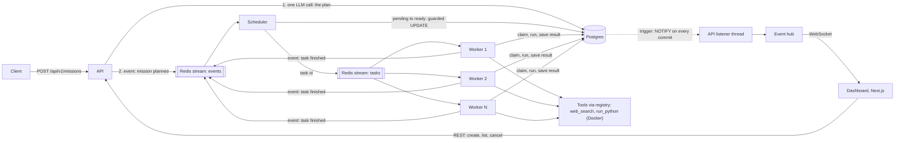

# AgentOS

A stateful multi-agent execution runtime: it plans a natural-language objective into a task graph,
schedules the tasks across worker processes over a message queue, enforces permissions on every
tool call, runs agent-written code in a locked-down container, and streams progress live.

> The model decides what it wants to do; the runtime decides whether it can.

**Status:** M0-M2 complete (planning, DAG scheduling, distributed workers, three agents,
sandboxed code execution). M3 in progress: the live event stream, mission list and cancel (#14)
and the Next.js dashboard (#15) are done; deployment and the demo are next (#16). See
[docs/ROADMAP.md](docs/ROADMAP.md), the API reference in [docs/API.md](docs/API.md) and the
dashboard's notes in [frontend/README.md](frontend/README.md).

## Architecture



- **Postgres is the source of truth.** Redis streams carry only ids ("look at this task").
- **Effectively-once execution on at-least-once delivery.** Every status change is a guarded
  `UPDATE`, so when a message is delivered twice, only one worker wins the claim.
- **Workers scale by running more of them.** Parallelism is measured, not claimed:
  see [docs/BENCHMARKS.md](docs/BENCHMARKS.md) (generate it with `make bench`).
- **Live updates come from the database itself.** A trigger announces every committed change;
  the API turns them into WebSocket messages. A rolled-back change is never announced, and no
  writer can forget to publish.
- **The registry, not the prompt, decides what an agent may do.** Agents hold capabilities;
  a tool call without the matching capability is refused.
- **Agent-written code runs in a container** (no network, read-only filesystem, no capabilities,
  non-root, memory/CPU/process limits) and the tool fails closed if Docker is unavailable.

## Quick start

```bash
cp .env.example .env              # then fill in TAVILY_API_KEY (and LLM settings) locally
python -m venv .venv && source .venv/bin/activate
pip install -r requirements.txt
make up                           # postgres + redis
make migrate && make seed         # schema and the three agents (migrate gives up after 10 s
                                  # and names the blocking session if a table is locked)
make sandbox                      # one-time: pull the code-execution image (needs Docker)
make web-install                  # one-time: the dashboard's dependencies (needs Node 20.9+)
make test
make web-check                    # the dashboard's type-check, lint and tests
```

Run it (five terminals):

```bash
make serve                        # API on http://localhost:8000  (docs at /docs)
make scheduler
WORKER_NAME=w1 make worker        # a second one: WORKER_NAME=w2 make worker
make web                          # the dashboard on http://localhost:3000
```

Open http://localhost:3000, describe an objective and watch the graph fill in. From a terminal,
`python -m scripts.try_stream "..."` shows the same live stream, and `python -m scripts.try_api "..."`
polls instead.

## API

Versioned under `/api/v1`: create, list (paged), get, cancel, and a live WebSocket stream per
mission. Full reference with message formats and close codes: [docs/API.md](docs/API.md).

## Safety notes

- Never commit `.env`. Secrets live there only, never as defaults in code.
- The API and the dashboard have no authentication yet (milestone M5): run them on localhost.
- `CODE_EXEC_BACKEND=docker` is the default. `CODE_EXEC_BACKEND=local` runs agent code on your own
  machine with no isolation and exists only as an explicit opt-in.
- Containers share the host kernel: strong isolation for a dev machine, not for hostile strangers.

## What works / what's planned
See the roadmap. Updated at the end of every milestone.
